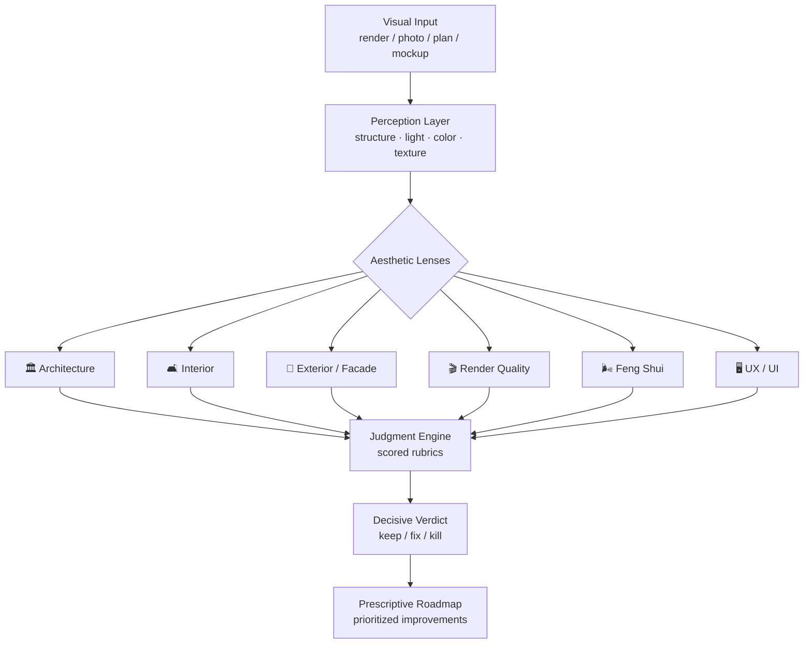

# 👁️ ALL SEEING EYE

### The Supreme Visual Intelligence & Aesthetic Judgment Engine

<div align="center">


</div>

---

> *"SEE EVERYTHING. UNDERSTAND EVERYTHING. JUDGE WITH TASTE."*
>
> — **ALL SEEING EYE** Design Philosophy

---

## 🇬🇧 English

### What It Is

**ALL SEEING EYE** is an elite-tier AI skill package that endows an agent with **world-class visual perception, architectural understanding, and aesthetic judgment**. It is not a simple image descriptor — it is a complete intelligence engine for evaluating, comparing, critiquing, and improving any visual work: architectural renders, interior/exterior design, facades, 3D scenes, floor plans, feng-shui layouts, UX/UI mockups, and photographic composition.

The engine combines:

- 🔬 **Vision Systems** — deep perceptual analysis of structure, proportion, light, color, texture, and materiality
- 🏛️ **Domain Knowledge** — architecture, interior design, exterior design, render quality, Feng Shui, and visual psychology
- ⚖️ **Judgment Frameworks** — scored rubrics that turn "looks nice" into precise, actionable verdicts
- 🎯 **Decision Intelligence** — decisive recommendations: what to keep, what to fix, and exactly how

### Key Features

| 🚀 Feature | Description |
|:---|:---|
| 🧠 Multi-Lens Vision | Evaluates images through dedicated lenses: architecture, interior, exterior, render quality, feng shui, photography, UX/UI |
| 📊 Scored Judgment | Every analysis produces structured scores per lens — no vague "feels off" without evidence |
| 🏗️ Domain Mastery | Deep reference libraries for classical & contemporary architecture, color theory, lighting design, material palettes |
| 🌬️ Feng Shui Engine | Bagua analysis, qi flow, element balance, and spatial harmony assessment |
| 🔄 Comparative Critique | Side-by-side evaluation of variants, iterations, and competitors with ranked recommendations |
| 🛠️ Actionable Prescriptions | Every flaw comes with a concrete fix — not just criticism, but a roadmap to excellence |
| 📐 Workflow Orchestration | Reusable analysis pipelines: render QA, facade comparison, interior audit, feng shui review |
| 🧪 Self-Testing Suite | Validation tests ensuring the engine's judgments stay consistent and calibrated |

### Architecture



### Directory Structure

```
all-seeing-eye/
├── SKILL.md                  # Skill manifest & activation instructions
├── README.md                 # This file — bilingual documentation
├── LICENSE                   # Proprietary license (All Rights Reserved)
├── MANIFEST.json             # Machine-readable package inventory
├── references/               # 📚 26 knowledge base modules
│   ├── vision-intelligence.md         #   structured perception & evidence extraction
│   ├── aesthetic-intelligence.md      #   beauty frameworks & quality calibration
│   ├── taste-engine.md                #   good-taste discrimination heuristics
│   ├── decision-engine.md             #   criteria weighting & confident verdicts
│   ├── visual-psychology.md           #   attention, emotion, cognitive response
│   ├── architectural-intelligence.md  #   proportion, massing, style, orders
│   ├── interior-design.md             #   spatial planning, circulation, furnishing
│   ├── exterior-design.md             #   facades, massing, curb appeal
│   ├── landscape-architecture.md      #   site context, planting, hardscape
│   ├── spatial-intelligence.md        #   3D spatial reasoning & viewpoint analysis
│   ├── 3d-modeling-intelligence.md    #   topology, UVs, asset quality
│   ├── feng-shui-intelligence.md      #   qi, bagua, five elements
│   ├── composition-intelligence.md    #   framing, balance, rhythm across media
│   ├── color-intelligence.md          #   color theory, harmony, psychology
│   ├── lighting-intelligence.md       #   light sources, shadows, color temp
│   ├── material-intelligence.md       #   material properties & fake detection
│   ├── photography-intelligence.md    #   composition, exposure, technical quality
│   ├── cinematography-intelligence.md #   shots, camera movement, visual storytelling
│   ├── rendering-intelligence.md      #   PBR realism & CG artifact diagnosis
│   ├── anti-ai-slop.md             #   generic/AI-looking visual detection
│   ├── confidence-calibration.md   #   verdict certainty vs. evidence strength
│   ├── quality-assurance.md        #   QA checklists & acceptance criteria
│   ├── reference-comparison.md     #   benchmarking vs. exemplars
│   ├── tool-awareness.md           #   tool & technique selection per input
│   └── visual-critique.md          #   observation→analysis→judgment craft
├── workflows/                # ⚙️ 10 reusable analysis pipelines
│   ├── analyze-image.md           #   comprehensive single-image analysis
│   ├── compare-images.md          #   side-by-side comparative critique
│   ├── architectural-review.md    #   building & facade review
│   ├── interior-review.md         #   interior space audit
│   ├── exterior-review.md         #   exterior & facade evaluation
│   ├── render-review.md           #   render quality audit
│   ├── feng-shui-review.md        #   feng shui assessment
│   ├── 3d-asset-review.md         #   3D asset & scene review
│   ├── aesthetic-decision.md      #   decisive choice between options
│   └── visual-improvement.md      #   prioritized fix prescriptions
├── frameworks/               # 📐 4 scoring & judgment frameworks
│   ├── visual-scoring.md          #   weighted scoring dimensions
│   ├── decision-matrix.md         #   keep/fix/redesign/reject verdicts
│   ├── professional-report.md     #   critique report standards
│   └── priority-system.md         #   impact-vs-effort improvement ranking
└── tests/                    # 🧪 6 calibration & validation suites
    ├── vision-test-cases.md        #   perception & evidence consistency
    ├── aesthetic-test-cases.md     #   aesthetic judgment benchmarks
    ├── architecture-test-cases.md  #   architectural review calibration
    ├── rendering-test-cases.md     #   render & 3D asset quality tests
    ├── feng-shui-test-cases.md     #   feng shui accuracy & honesty
    └── decision-quality-tests.md   #   verdict stability & edge cases
```

### Quick Install

Copy the entire `all-seeing-eye/` folder into your agent's skills directory:

```bash
# Claude Code / agent skills convention
cp -r all-seeing-eye ~/.claude/skills/

# or any skills directory your agent runtime supports
cp -r all-seeing-eye /path/to/agent/skills/
```

Then invoke the skill by name or description — the agent loads `SKILL.md`, pulls the relevant reference modules, and runs the matching workflow.

### Usage Examples

**1️⃣ Analyze an architectural render**

> *"Use ALL SEEING EYE to audit this exterior render — evaluate composition, lighting realism, material quality, and give me a prioritized fix list."*

**2️⃣ Compare building facades**

> *"Compare these three facade designs side-by-side with ALL SEEING EYE — score each on proportion, rhythm, materiality, and street presence. Tell me which one ships."*

**3️⃣ Feng shui review**

> *"Run a feng shui assessment on this floor plan with ALL SEEING EYE — check the bagua, entry qi flow, element balance, and bedroom placement. Give me a decisive verdict."*

### Supported Modes

| 🎯 Mode | Input | Output |
|:---|:---|:---|
| 🔍 **Analyze** | Single image / render / plan | Scored multi-lens critique + fix list |
| ⚖️ **Compare** | 2–N variants | Ranked comparison + winner + rationale |
| 🏛️ **Architectural Review** | Building exteriors / facades | Proportion, rhythm, style, context analysis |
| 🛋️ **Interior Audit** | Interior shots / plans | Spatial flow, lighting, furniture, color harmony |
| 🌬️ **Feng Shui Review** | Floor plans / site layouts | Bagua map, qi flow, element & placement verdict |
| 🎨 **Aesthetic Direction** | Moodboard / concept | Style diagnosis + refinement roadmap |
| 🧪 **Calibration Check** | Test image sets | Consistency validation of judgments |

### Quality Standards

- **Evidence-first** — every judgment cites visible features; no hand-waving
- **Calibrated scoring** — rubrics keep verdicts consistent across sessions
- **Decisive by design** — always ends with a clear recommendation, never "it depends"
- **Domain depth** — references encode real architectural & design knowledge, not generic advice
- **Actionable output** — fixes are specific enough to execute immediately

---
---

## 🇮🇩 Bahasa Indonesia

### Apa Ini

**ALL SEEING EYE** adalah paket *AI skill* kelas elite yang membekali agen dengan **kemampuan visual, pemahaman arsitektur, dan penilaian estetika setara pakar**. Ini bukan sekadar deskripsi gambar — melainkan mesin kecerdasan lengkap untuk mengevaluasi, membandingkan, mengkritik, dan menyempurnakan setiap karya visual: render arsitektur, desain interior/eksterior, fasad, scene 3D, denah, tata letak feng shui, mockup UX/UI, dan komposisi fotografi.

Mesin ini memadukan:

- 🔬 **Sistem Vision** — analisis perseptual mendalam terhadap struktur, proporsi, cahaya, warna, tekstur, dan materialitas
- 🏛️ **Pengetahuan Domain** — arsitektur, desain interior, desain eksterior, kualitas render, Feng Shui, dan psikologi visual
- ⚖️ **Framework Penilaian** — rubrik terstruktur yang mengubah "kelihatan bagus" menjadi vonis presisi dan bisa ditindaklanjuti
- 🎯 **Kecerdasan Keputusan** — rekomendasi tegas: apa yang dipertahankan, apa yang diperbaiki, dan persis bagaimana caranya

### Fitur Utama

| 🚀 Fitur | Deskripsi |
|:---|:---|
| 🧠 Vision Multi-Lensa | Mengevaluasi gambar lewat lensa khusus: arsitektur, interior, eksterior, kualitas render, feng shui, fotografi, UX/UI |
| 📊 Penilaian Terukur | Setiap analisis menghasilkan skor terstruktur per lensa — tanpa "rasanya kurang" tanpa bukti |
| 🏗️ Penguasaan Domain | Pustaka referensi mendalam untuk arsitektur klasik & kontemporer, teori warna, desain pencahayaan, palet material |
| 🌬️ Mesin Feng Shui | Analisis bagua, aliran qi, keseimbangan elemen, dan penilaian harmoni ruang |
| 🔄 Kritik Komparatif | Evaluasi berdampingan antar-varian, iterasi, dan kompetitor dengan rekomendasi terperingkat |
| 🛠️ Resep Tindakan | Setiap kekurangan disertai perbaikan konkret — bukan sekadar kritik, tapi peta jalan menuju keunggulan |
| 📐 Orkestrasi Workflow | Pipeline analisis siap pakai: QA render, perbandingan fasad, audit interior, review feng shui |
| 🧪 Suite Uji Mandiri | Tes validasi agar penilaian mesin tetap konsisten dan terkalibrasi |

### Struktur Direktori

```
all-seeing-eye/
├── SKILL.md                  # Manifest skill & instruksi aktivasi
├── README.md                 # File ini — dokumentasi dwibahasa
├── LICENSE                   # Lisensi proprietary (All Rights Reserved)
├── MANIFEST.json             # Inventaris paket machine-readable
├── references/               # 📚 26 modul basis pengetahuan (vision, estetika, taste, keputusan, psikologi visual, kritik visual, arsitektur, interior, eksterior, landscape, spasial, 3D, feng shui, komposisi, warna, cahaya, material, foto, sinematografi, render, anti-slop, QA, kalibrasi…)
├── workflows/                # ⚙️ 10 pipeline analisis siap pakai
├── frameworks/               # 📐 4 framework skor & penilaian
└── tests/                    # 🧪 6 tes kalibrasi & validasi
```

### Instalasi Cepat

Salin seluruh folder `all-seeing-eye/` ke direktori skills agen Anda:

```bash
cp -r all-seeing-eye ~/.claude/skills/
# atau direktori skills apapun yang didukung runtime agen Anda
cp -r all-seeing-eye /path/ke/skills/agen/
```

Lalu panggil skill berdasarkan nama atau deskripsinya — agen akan memuat `SKILL.md`, menarik modul referensi yang relevan, dan menjalankan workflow yang cocok.

### Contoh Penggunaan

**1️⃣ Menganalisis render arsitektur**

> *"Gunakan ALL SEEING EYE untuk mengaudit render eksterior ini — nilai komposisi, realisme pencahayaan, kualitas material, dan beri saya daftar perbaikan prioritas."*

**2️⃣ Membandingkan fasad bangunan**

> *"Bandingkan tiga desain fasad ini dengan ALL SEEING EYE — beri skor masing-masing untuk proporsi, ritme, materialitas, dan kehadiran di jalan. Bilang mana yang harus dipakai."*

**3️⃣ Review feng shui**

> *"Jalankan penilaian feng shui pada denah ini dengan ALL SEEING EYE — cek bagua, aliran qi pintu masuk, keseimbangan elemen, dan penempatan kamar tidur. Beri vonis tegas."*

### Mode yang Didukung

| 🎯 Mode | Input | Output |
|:---|:---|:---|
| 🔍 **Analyze** | Satu gambar / render / denah | Kritik multi-lensa ber-skor + daftar perbaikan |
| ⚖️ **Compare** | 2–N varian | Perbandingan terperingkat + pemenang + alasan |
| 🏛️ **Arsitektur Review** | Eksterior / fasad bangunan | Analisis proporsi, ritme, gaya, konteks |
| 🛋️ **Audit Interior** | Foto / denah interior | Aliran ruang, pencahayaan, furnitur, harmoni warna |
| 🌬️ **Review Feng Shui** | Denah / tata letak site | Peta bagua, aliran qi, vonis elemen & penempatan |
| 🎨 **Arah Estetika** | Moodboard / konsep | Diagnosis gaya + peta jalan penyempurnaan |
| 🧪 **Calibration Check** | Set gambar uji | Validasi konsistensi penilaian |

### Standar Kualitas

- **Berbasis bukti** — setiap vonis mengutip fitur visual yang terlihat; tanpa asal tebak
- **Skor terkalibrasi** — rubrik menjaga konsistensi vonis antar sesi
- **Tegas by design** — selalu diakhiri rekomendasi jelas, bukan "tergantung kasus"
- **Kedalaman domain** — referensi memuat pengetahuan arsitektur & desain nyata, bukan nasihat generik
- **Output bisa ditindaklanjuti** — perbaikan cukup spesifik untuk langsung dieksekusi

---

<div align="center">

**ALL SEEING EYE** — *See everything. Understand everything. Judge with taste.*

© 2026 VeryCoolApps (PT. Agra Karya Digital) — All Rights Reserved · [vcadeveloper.com](https://www.vcadeveloper.com)

</div>
